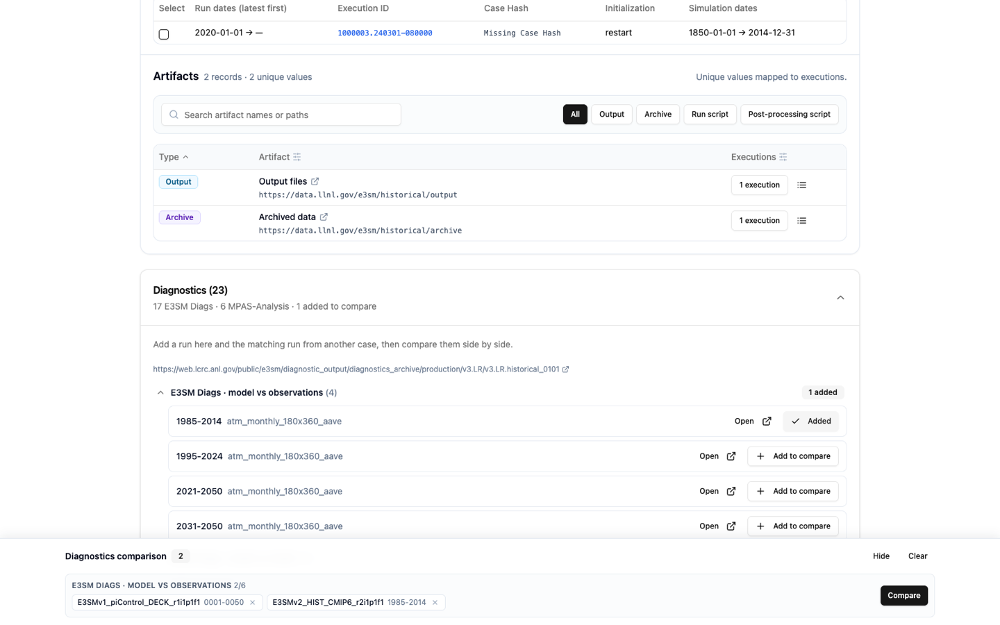
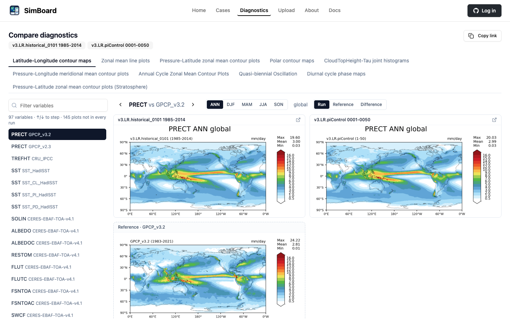

# Compare Diagnostics

SimBoard shows E3SM Diags and MPAS-Analysis plots from several runs side by
side: a historical run against a pre-industrial control, AMIP against coupled,
or one case at two periods.

> This feature is new and still changing.

## From case pages

A case with a [diagnostics link](diagnostics.md) has a **Diagnostics** card at
the bottom of its page listing the runs it published, grouped into E3SM Diags
model-vs-observations, model-vs-model, and MPAS-Analysis. Select **Add to
compare** on a run, open another case, and add its matching run. The picks
collect in the **Diagnostics comparison** bar, which stays with you across
pages. Select **Compare** in the bar.

## From run addresses

Open **Diagnostics** in the top menu and paste each run's address: an E3SM
Diags `.../viewer/` page or an MPAS-Analysis run directory. Labels are
optional. The page also opens the examples IICE shipped with one click.

Addresses must be public E3SM web content on `portal.nersc.gov` or
`web.lcrc.anl.gov`. Some older MPAS-Analysis runs do not show their case name
in the address; as in IICE, give them a label starting with `!` followed by the
case name, for example `!ECwISC30to60E2r1.CRYO1850.N2dependent yrs 1-10`.

## The comparison

| Control | What it does |
| --- | --- |
| Plot set tabs | E3SM Diags sets the runs share, or **Ocean** and **Sea ice** for MPAS-Analysis. |
| Variable list | Each variable and what it is compared against. Type to filter; ↑/↓ steps. |
| Season, Region | Where a plot has them. MPAS-Analysis regions include depths and transects. |
| Panel | E3SM Diags only: each run's field (**Run**, with the reference once below), or every run's **Reference** or **Difference** panel. |
| Copy link | The page address reproduces exactly what is shown. |

Only plots every run published are offered; the variable list says how many
were left out. Runs of different kinds share no plots, so compare like with
like. A run that cannot be read is named and left out.

Not offered yet: E3SM Diags tables, Taylor diagrams, CMIP6 summaries and
tropical subseasonal plots. Use **Open** on the run to see those in its own
viewer.
