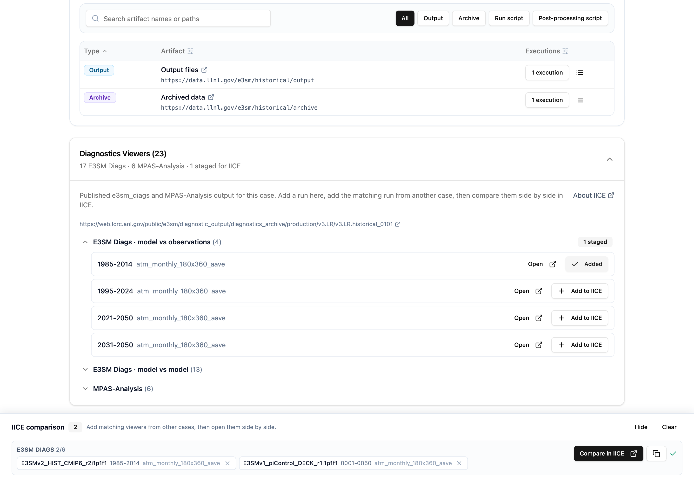
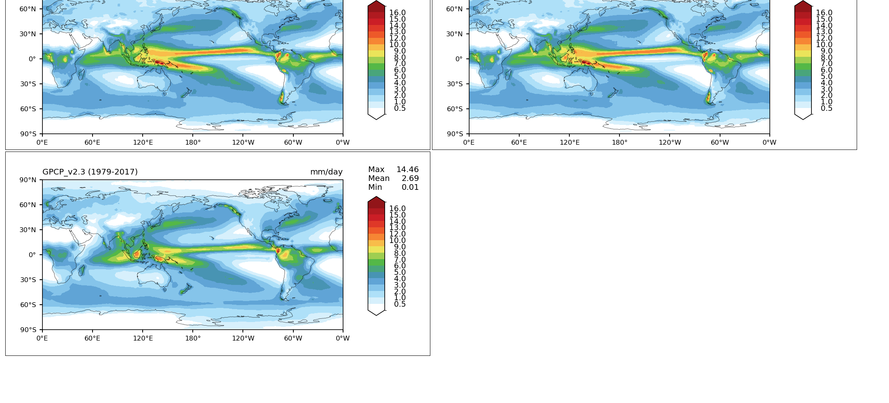

# Compare Diagnostics Across Cases

SimBoard lists the diagnostics runs published for a case and can open several of
them side by side in
[IICE](https://portal.nersc.gov/project/e3sm/iice/), the Interface for
Inter-Comparison of E3SM diagnostics. Picks are collected across cases, so you can
compare a historical run against a pre-industrial control, an AMIP run against a
coupled run, or the same case at two different periods.

This page covers using the comparison. To get diagnostics linked to a case in the
first place, see [Publish Diagnostics Links](diagnostics.md).

## Find the diagnostics runs for a case

Open a case and scroll to **Diagnostics Viewers** at the bottom of the page. The
heading shows how many runs were found, for example
`Diagnostics Viewers (23)` with `17 E3SM Diags · 6 MPAS-Analysis`. Expand it to see
them.

A case's diagnostics link points at the top of its published output. SimBoard reads
that location and lists the individual runs beneath it, grouped by what they
compare:

| Group | What it contains |
| --- | --- |
| **E3SM Diags · model vs observations** | Runs comparing the simulation against observational data. Open by default. |
| **E3SM Diags · model vs model** | Runs comparing the simulation against another simulation. |
| **MPAS-Analysis** | Ocean and sea-ice analysis runs, labelled with their timeseries and climatology periods. |

Each row shows the period the run covers, such as `1985-2014`, and the zppy
subsection that produced it, such as `atm_monthly_180x360_aave`. A case often
publishes the same diagnostics for several periods.

**Open** goes straight to that run's own viewer, exactly as the case's diagnostics
link does today.

## Build a comparison

1. Select **Add to IICE** on a run.
2. The **IICE comparison** bar appears at the bottom of the window with your
   selection.
3. Open another case, expand its **Diagnostics Viewers**, and add the matching run.
   The bar follows you between pages, so you can search the catalog in between.
4. Select **Compare in IICE**.

Compare the same kind of diagnostics from each case. IICE renders a whole
comparison from one template, so model-vs-observations and model-vs-model runs
cannot appear in the same comparison; the bar keeps them in separate groups with
a link each.

IICE opens with the cases side by side and the familiar e3sm_diags navigation:
choose a plot set, a variable, and a season, or switch between total fields and
difference plots.

Use the copy button next to **Compare in IICE** to copy the link instead of opening
it, for sharing in email or on a Confluence page.

## Comparison bar

| Control | What it does |
| --- | --- |
| **Compare in IICE** | Opens the comparison. Enabled once at least two runs are staged. |
| Copy | Copies the comparison link to the clipboard. |
| **Hide** | Collapses the bar without losing your selection. |
| **Clear** | Empties the comparison. |
| `×` on a chip | Removes one run. |

The bar builds one link per comparison: E3SM Diags and MPAS-Analysis open in
different IICE pages, and model-vs-observations and model-vs-model runs use
different templates. Each group is labelled and counted, such as
`E3SM DIAGS · MODEL VS OBSERVATIONS 2/6`. Six per group is the practical limit:
IICE places every case in a single row across the page, and beyond six the plots
are too small to read.

On a short window the bar scrolls internally rather than growing past the edge
of the screen.

Your selection is kept in the browser, so it survives navigation and page reloads,
and is not shared between browsers or machines.

## Model-vs-model runs need a reference case

When a run compares one simulation against another, e3sm_diags includes the
reference simulation's name in every image filename. IICE cannot locate those
images unless it is told that name, so chips for model-vs-model runs include a
**vs ref case** field, and **Compare in IICE** stays disabled until it is filled in.

SimBoard pre-fills the short tag zppy used for the run, such as `PI100` or `1st50`.
That tag is usually an abbreviation rather than the reference case name. Replace it
with the full case name, for example `v3.LR.piControl`. The run's own viewer, opened
with **Open**, names the reference simulation in its plots.

## Troubleshooting

**The Diagnostics Viewers section is not on the case page.** The case has no
diagnostics link yet. See [Publish Diagnostics Links](diagnostics.md).

**It says no runs were found.** The link points at a location SimBoard could read
but which contains no recognisable e3sm_diags or MPAS-Analysis output. Confirm the
published output is complete and matches the expected archive layout.

**It says the link is not on a reviewed diagnostics archive.** SimBoard lists runs
only for output published to the reviewed archives at NERSC and LCRC. Older or
hand-entered links to other locations still open normally with **Open**, but their
runs cannot be listed.

**Only some runs are listed.** A message reports when a case publishes more runs
than SimBoard listed. Open the archive link shown above the groups to browse the
rest, and report the case so the limit can be raised.

**IICE opens but the plots are missing.** The published output may have been moved
or deleted after it was linked. Check that **Open** works for each run in the
comparison. For model-vs-model runs, confirm the reference case name is correct.

**A run is listed but its period looks wrong.** Periods come from the directory
names zppy creates. If they disagree with the diagnostics themselves, re-publish
the output so the names match.
