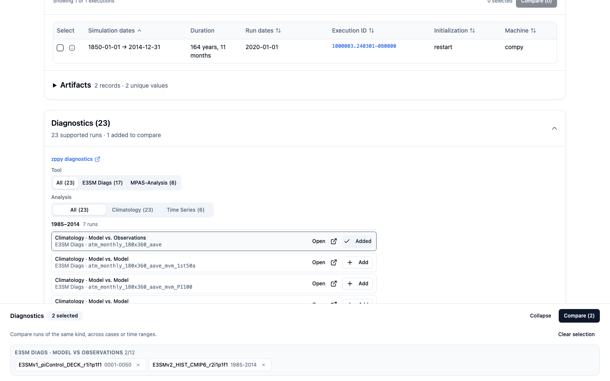
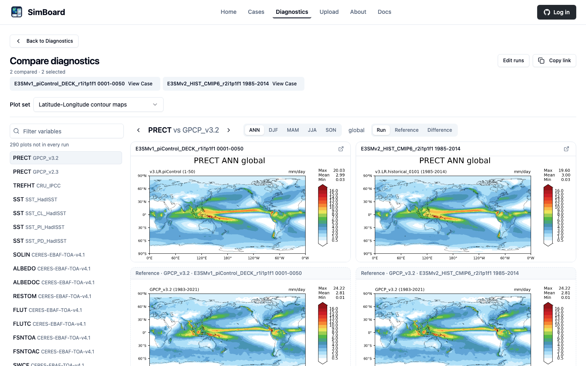

# Compare Diagnostics

SimBoard shows E3SM Diags and MPAS-Analysis plots from several runs side by
side: a historical run against a pre-industrial control, AMIP against coupled,
or one case at two periods. The comparison follows the approach of
[IICE](https://github.com/E3SM-Project/IICE), E3SM's standalone intercomparison
tool, including its example comparisons and label conventions.

> This feature is new and still changing.

## From case pages

A case with a [diagnostics link](diagnostics.md) has a **Diagnostics** card above
**Change History**, expanded when supported runs exist. Runs are grouped by time
range and retain their exact identifiers. **All**, **Climatology**, and
**Time Series** show per-case counts.
Tool filters show unique counts for **All**, **E3SM Diags**, and **MPAS-Analysis**.
Both **Tool** and **Analysis** filters remain visible. Counts show unique runs
matching the other filter; unavailable options are disabled. If case data no
longer supports an active filter, it resets to **All**.
MPAS runs use climatology years first, otherwise time-series years, otherwise
**Unknown time range**. Each run appears once, with both indexed ranges shown
when available. Filters do not change its primary time-range group.
Select **Add** on runs
from different cases or different periods of one case. Picks persist across
pages in a compact selection tray. **Expand** reviews or removes selections;
**Compare** opens plots directly. Choose a compatible group if several tools
or comparison types are selected.

Resources keep their original output links. **View in Diagnostics**, when
available, expands the matching structured diagnostics section.

## From the Diagnostics workspace

Open **Diagnostics** in the top menu. **Browse SimBoard** searches case names
and shows cases with discovered E3SM Diags or MPAS-Analysis runs. Select a case
to pick runs. Discovery checks a bounded page at a time; use **Load more cases**
to continue. General zppy directories are not selectable runs. Some archives
may be unavailable; retry discovery rather than treating those cases as empty.

**Add by URL** accepts E3SM Diags `.../viewer/` pages and MPAS-Analysis run
directories, with optional labels. It also opens the examples shipped with
IICE. Case pages, the tray, and the workspace synchronize known selections
automatically. Choose a comparison group to review another staged diagnostic
kind without mixing groups automatically.

**Selected runs** sits below discovery. Expand it to edit or remove runs, or use
**View Case** to return to a linked case. Search, active case, filters, and
selections persist across navigation and refreshes. Explicit shared URLs take
precedence over local selections.

**Compare** checks for shared plots only when clicked. Compatible runs open the
viewer; incompatible selections stay in the workspace. Failed checks preserve
selections and offer a retry.

In an active comparison, **Edit runs** adds, removes, or replaces runs without
leaving the viewer. **Apply changes** updates the comparison; **Cancel** keeps
the original. The global tray is hidden in this workspace.

Addresses must be public E3SM web content on `portal.nersc.gov` or
`web.lcrc.anl.gov`. Some older MPAS-Analysis runs do not show their case name
in the address; as in IICE, give them a label starting with `!` followed by the
case name, for example `!ECwISC30to60E2r1.CRYO1850.N2dependent yrs 1-10`.

## The comparison

| Control             | What it does                                                                                                                                                                                                                                                                 |
| ------------------- | ---------------------------------------------------------------------------------------------------------------------------------------------------------------------------------------------------------------------------------------------------------------------------- |
| Diagnostic category | E3SM Diags sets the runs share, or **Ocean** and **Sea ice** for MPAS-Analysis.                                                                                                                                                                                              |
| Variable list       | Each variable and what it is compared against. Type to filter; ↑/↓ steps.                                                                                                                                                                                                    |
| Season, Region      | Where a plot has them. MPAS-Analysis regions include depths and transects.                                                                                                                                                                                                   |
| Panel               | E3SM Diags only: each run's field (**Run**, with each distinct reference below), or every run's **Reference** or **Difference** panel. Difference means each model minus its reference, not subtraction between selected simulations. Published color scales stay unchanged. |
| Copy link           | The page address reproduces exactly what is shown.                                                                                                                                                                                                                           |

Only plots every run published are offered; the variable list says how many
were left out. Runs of different kinds share no plots, so compare like with
like. Unreadable runs and unavailable images show recovery actions; unavailable
run cells retain their position.

Full diagnostic URLs, labels, category, plot, and panel remain in the page URL.
Long comparison links are intentional: they restore the view after reload or
in another browser, independently of staged selections. Short display labels
do not change those URLs.

Not offered yet: E3SM Diags tables, Taylor diagrams, CMIP6 summaries and
tropical subseasonal plots. Use **Open** on the run to see those in its own
viewer.
